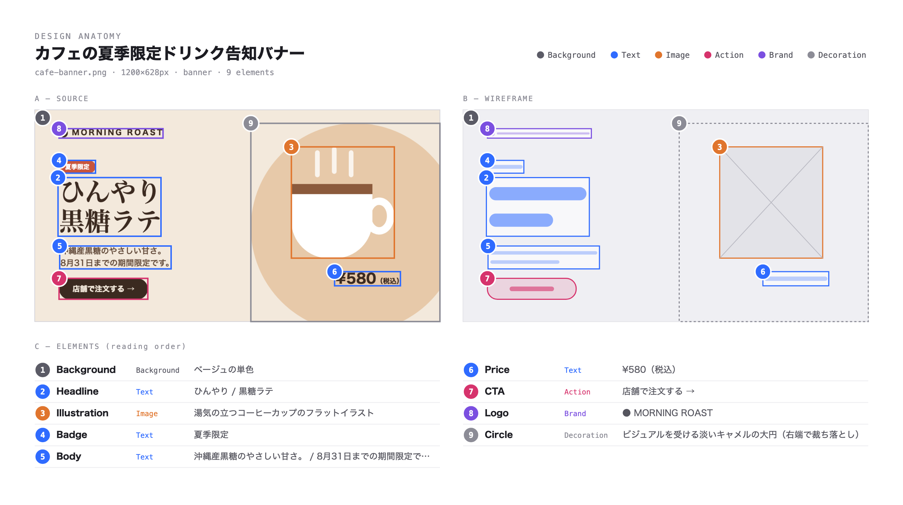

# design-anatomy

> An agent skill that turns a flat design image into an **anatomy sheet** — numbered markers on the original, a wireframe redraw, and an element list, in one image.
>
> バナーやポスターなどのデザイン画像を、背景・見出し・サブコピー・イラスト・CTA などの要素に分解して、**1枚の図版（anatomy 図）** にするエージェント用 skill です。



Works with any agent that reads the [Agent Skills](https://agentskills.io) `SKILL.md` format — Claude Code, Codex, Gemini CLI, GitHub Copilot, and others.

## How it works / しくみ

| step | who | what |
|---|---|---|
| measure | script | read image size (`probe`) |
| OCR | script | text lines + pixel boxes (`ocr`: macOS Vision → tesseract) |
| understand | **agent** | decide each element's role, reading order, and content by looking at the image |
| write | agent | `<image>.anatomy.json` ([schema](skills/design-anatomy/schema/anatomy.schema.json)) |
| draw | script | SVG/PNG sheet (`render`) |

The agent does the judgement; a zero-dependency Node script does the deterministic parts.
判断はエージェント、計測・OCR・描画は依存ゼロの Node スクリプト、という分担です。

## Install / インストール

```bash
npx skills add masa-sumimoto/design-anatomy
```

Or copy `skills/design-anatomy/` into your agent's skills directory (e.g. `~/.claude/skills/`, `~/.codex/skills/`).

Requirements: Node ≥ 18. Optional: macOS (Vision OCR, Japanese-ready) or `tesseract`; `rsvg-convert` or Chrome for PNG output.

## Usage / 使い方

Ask your agent:

> このバナーを design-anatomy で分解して `./banner.png`
>
> Break down `./poster.jpg` with design-anatomy.

Or run the script directly:

```bash
S=skills/design-anatomy/scripts/anatomy.mjs
node $S probe banner.png
node $S ocr banner.png
node $S validate banner.anatomy.json
node $S render banner.anatomy.json --png                 # sheet
node $S render banner.anatomy.json --mode wireframe --png
```

## Roles / 役割

`background` · `headline` `subheadline` `body` `caption` `price` `date` `label` · `illustration` `photo` `product` `character` `icon` · `cta` `button` `link` · `logo` · `badge` `decoration` `shape` `divider` · `container` `card` `frame` `nav` · `other`

Each role belongs to a color group (Text / Image / Action / Brand / Decoration / Container) used in the sheet.

## License

MIT
